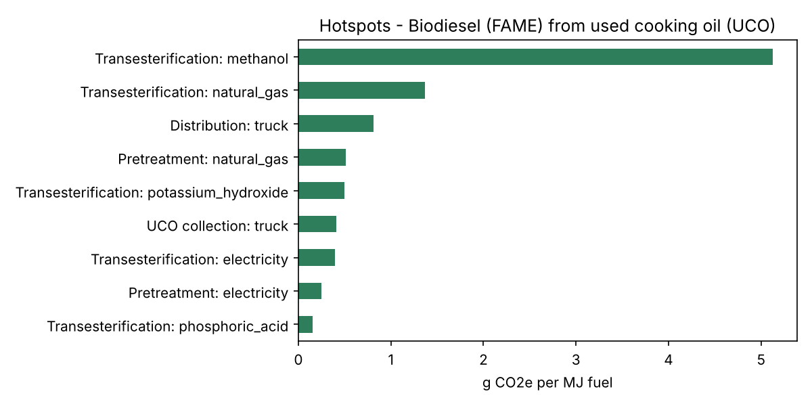

# RED GHG Calculator – renewable fuel supply chains

A small Python tool that calculates the **greenhouse gas intensity (carbon intensity, CI)** of a renewable fuel pathway following the **EU Renewable Energy Directive (RED II), Annex V, Part C**. It also checks the result against the **GHG savings thresholds**.

The example pathway is **biodiesel (FAME) from used cooking oil (UCO)**.



## Method

**E = e_ec + e_l + e_p + e_td + e_u − e_sca − e_ccs − e_ccr** (g CO₂e per MJ fuel)

**Savings = (EF − E) / EF**, with the fossil fuel comparator EF = 94 g CO₂e/MJ

- **Wastes and residues** (here UCO) count as **zero emissions up to collection**, so e_ec = 0.
- **Co-products** (here crude glycerine) share emissions **by energy content (lower heating value)**, for all emissions up to and including the process step that produces the co-product. Steps after that, such as distribution, are not allocated.
- **Savings thresholds** depend on when the installation started operating: 50% (until 5 Oct 2015), 60% (6 Oct 2015 – 31 Dec 2020), 65% (from 1 Jan 2021).
- Savings terms (e_sca, e_ccs, e_ccr) are subtracted automatically.

## Example result

```
Pathway: Biodiesel (FAME) from used cooking oil (UCO)
Allocation factor fuel vs. co-products (energy basis): 0.959

Base case
  Carbon intensity E = 9.52 g CO2e/MJ
  GHG savings vs. fossil comparator = 89.9% (threshold 65%: OK)

Scenario: renewable electricity                     E = 8.94 g CO2e/MJ  (90.5 %)
Scenario: bio-methanol instead of fossil methanol   E = 5.69 g CO2e/MJ  (93.9 %)
Scenario: both                                      E = 5.10 g CO2e/MJ  (94.6 %)
```

The hotspot analysis shows that **fossil methanol** is by far the largest lever for lowering the CI score of this pathway, followed by process heat.

## Run it

```bash
pip install -r requirements.txt
python red_ghg.py   # calculates, prints scenarios, saves a results table and the hotspot chart
pytest              # 9 checks: allocation, savings formula, thresholds, credits, missing data
```

## Add your own pathway

Create two files. No code changes are needed:

| File | Content |
|---|---|
| `<pathway>_steps.csv` | One row per input: supply-chain step, RED term (`eec`, `el`, `ep`, `etd`, `eu`, `esca`, `eccs`, `eccr`), amount per fuel output, unit, whether it happens before the co-product step |
| `<pathway>_settings.json` | Fuel output and heating value, co-products, fossil comparator, installation start date |

Emission factors for all inputs go in `emission_factors_fuels.csv`. If an input has no factor, the script stops and names it.

## Limitations

- **All process data and emission factors are illustrative.** Real calculations use actual plant data, or the default values and emission factors from the RED annexes, the implementing regulation and the certification scheme (e.g. ISCC EU).
- No land-use change (e_l) or soil-carbon (e_sca) example. The terms are supported but not used in this waste-based pathway.
- RFNBO and RCF fuels follow a separate methodology (Delegated Regulation (EU) 2023/1185) and are not covered.
